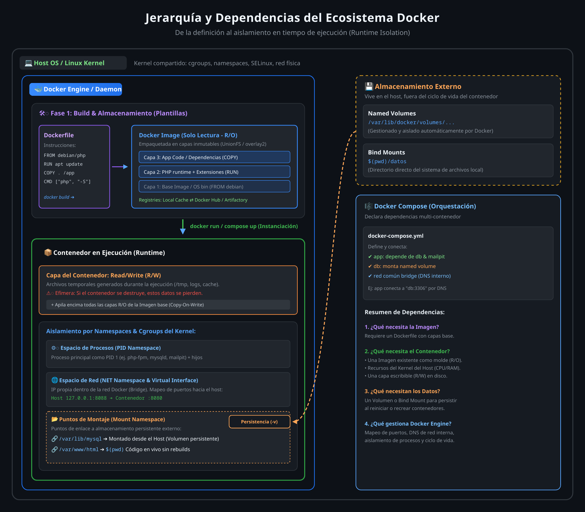
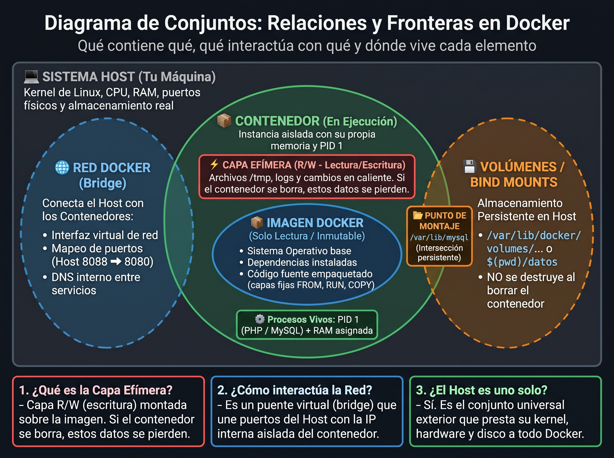

#

[Comandos esenciales](comandos.md)

[Conceptos](conceptos.md)

[Dockerfile](dockerfile.md)

[Comandos de ejemplo](ejemplos.md)

[Flujo de trabajo](work_flow.md)

[Jerarquia de dependencias](jerarquia_dependencias.png)

