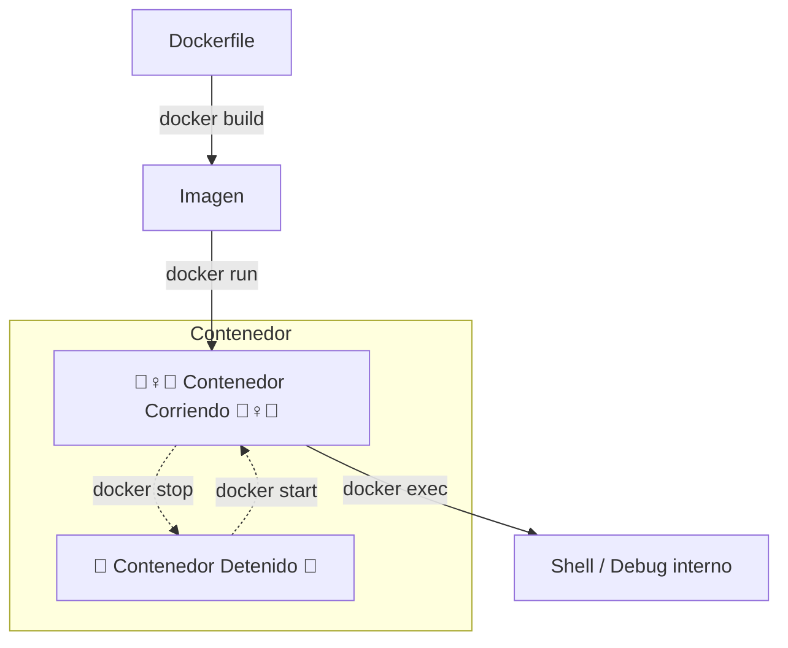
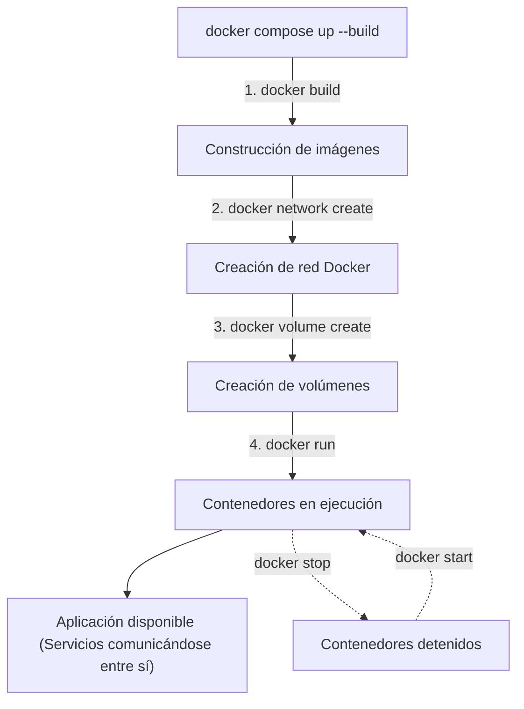
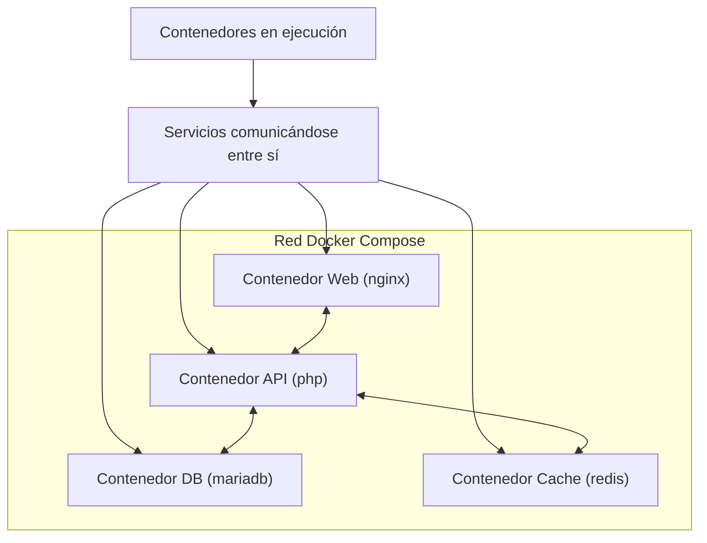

# Comparativa de Comandos Esenciales de Docker

Diferencias clave entre cuatro de los comandos más utilizados en el ciclo de vida de Docker: `docker build`, `docker run`, `docker exec` y `docker start` y `docker compose`

## Tabla Comparativa Integral: Docker CLI vs. Docker Compose

| Comando CLI Clásico | Equivalente en Docker Compose | Nivel / Ámbito | Entrada Principal | Salida / Efecto | Estado Requerido | Propósito Principal y Rol en Compose |
| :--- | :--- | :--- | :--- | :--- | :--- | :--- |
| **`docker build`** | `docker compose build` | Objeto individual (Imagen) | `Dockerfile` + Contexto de compilación | Nueva imagen local (`image_id` / `name:tag`) | Archivos fuente locales disponibles | Empaquetar y compilar código, runtime y dependencias en una imagen inmutable. En Compose, compila los servicios definidos con `build:`. |
| **`docker run`** | `docker compose up`<br>*(o `compose run`)* | Objeto individual (Contenedor) vs. Stack completo | Imagen local o de registry (`nginx`, etc.) + Flags (`-p`, `-v`, `-e`) / Archivo YAML | Nuevo contenedor o stack completo en ejecución | Imagen disponible o acceso a registry | Instanciar y arrancar desde cero asignando red, puertos y volúmenes. `compose up` crea y arranca toda la arquitectura declarada; `run` corre tareas puntuales. |
| **`docker start`** | `docker compose start` | Contenedor individual | Contenedor existente detenido (`name` o `ID`) | Reactivación del proceso principal | Contenedor previamente creado (estado `Exited`) | Reanudar la ejecución de contenedores detenidos sin alterar capas ni recrear redes/volúmenes. |
| **`docker exec`** | `docker compose exec <servicio> <cmd>` | Contenedor individual | Contenedor activo + binario/comando (`bash`, `sh`) | Proceso secundario interno (dentro del namespace del contenedor) (Shell / Salida del comando) | Contenedor en ejecución (estado `Up`) | Acceder interactivamente, depurar o ejecutar tareas administrativas sin reiniciar. En Compose, opera por nombre lógico de servicio. |
| **`docker stop`** | `docker compose stop` | Contenedor individual | Contenedor en ejecución (`name` o `ID`) | Proceso principal finalizado (`SIGTERM` / `SIGKILL`) | Contenedor en ejecución (estado `Up`) | Detener temporalmente los procesos del servicio conservando su estado y asignaciones intactas. |
| **`docker rm`** | `docker compose down` | Objeto individual vs. Stack completo | Contenedor detenido o forzado (`-f`) | Eliminación del contenedor / Liberación de namespaces | Contenedor detenido (o forzado) | Destruir y limpiar contenedores. En Compose, `down` detiene y destruye ordenadamente contenedores y redes creadas por el YAML. |
| **`docker compose`** *(up/down)* | `docker compose` *(nativo)* | Multi-contenedor / Orquestación declarativa | Archivo de definición `docker-compose.yml` | Stack completo orquestado (redes, volúmenes, imágenes y servicios) | Archivo YAML válido y Docker Daemon activo | Orquestar, levantar y administrar ciclos de vida completos de arquitecturas multi-servicio de forma declarativa y reproducible. |


---


## Flujo de Trabajo Típico Docker Container (Lifecycle)




## Diferencias Arquitectónicas Clave

### 1. Modelo Imperativo vs. Modelo Declarativo
* **Docker CLI (`build`, `run`, `start`, `exec`):** Enfoque **imperativo**. Debes especificar paso a paso cada parámetro por línea de comandos (flags `-p`, `-v`, `-e`, `--name`, `--network`).
* **Docker Compose:** Enfoque **declarativo**. Describes el estado deseado de toda la arquitectura en `docker-compose.yml`, y el motor se encarga de reconciliar y ejecutar los pasos necesarios.
* En ambos casos puedes indicar un _Dockerfile_ para crear una imagen o una _public image_, en el _YAML_ usa `image` para _public image_ o `build` para _Dockerfile_.

### 2. Flujo del Ciclo de Vida Integrado (Docker compose)
A diferencia de los comandos individuales, `docker compose` abstrae varios pasos en una sola instrucción:


```
                  ┌──────────────── docker-compose.yml ────────────────┐
                  │                                                    │
                  │  [build] ───────► [run / up] ───────► [stop/start] │
                  │     ▲                   ▲                   ▲      │
                  └─────┼───────────────────┼───────────────────┼──────┘
                        │                   │                   │
                  docker build         docker run          docker start
```


* `docker compose up -d --build`: Ejecuta de forma encadenada el equivalente a `docker build` + `docker run` (creando redes y volúmenes automáticamente).
* `docker compose exec <servicio> <cmd>`: Opera igual que `docker exec`, pero resuelve el nombre del servicio sin necesidad de buscar el ID del contenedor.





El diagrama ilustra cómo funciona un _docker-compose.yml_: una red compartida y varios contenedores arrancados como parte del mismo proyecto.



